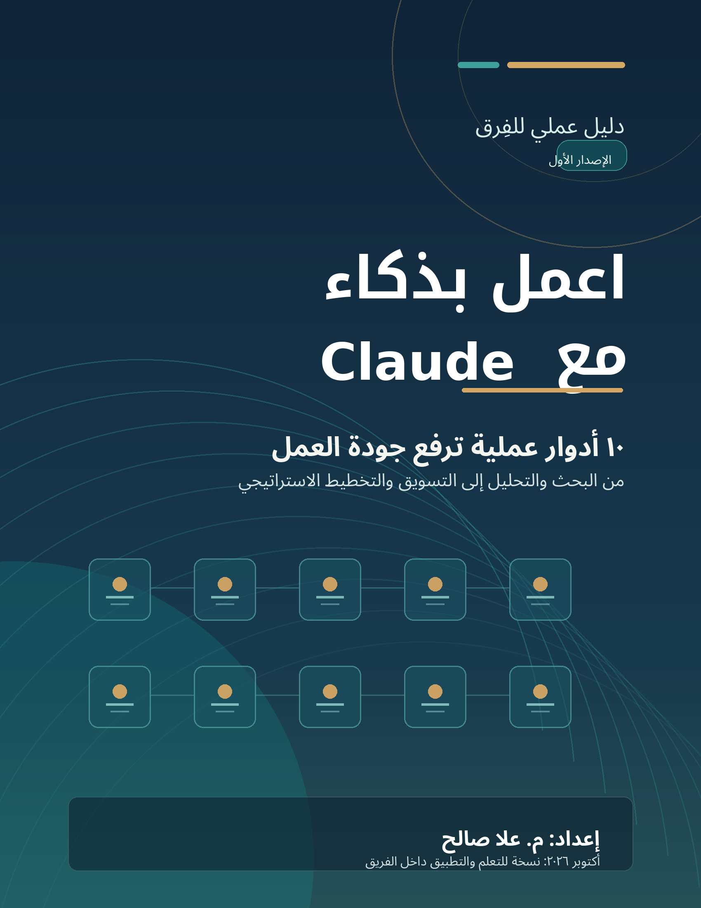
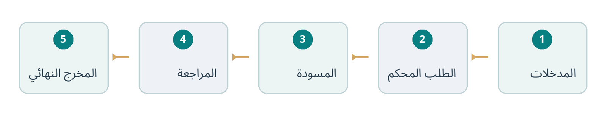
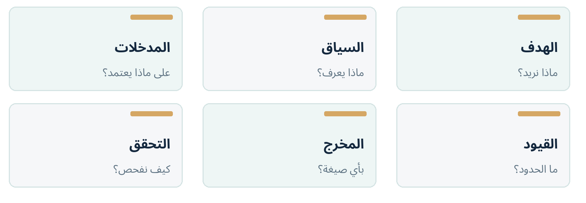

<!-- دليل تدريبي بالعربية؛ حافظ على اتجاه العرض من اليمين إلى اليسار -->
<div dir="rtl" align="right">

<p align="center"></p>

# اعمل بذكاء مع Claude
**دليل عملي للفريق — ١٠ أدوار، وخطوات تنفيذ، وبرومبتات قابلة للنسخ**  
**إعداد: م. علا صالح**

> **كيف تستفيد من هذه النسخة؟** يمكنك تصفّح الدليل مباشرةً من GitHub، أو فتح [النسخة المصممة بصيغة HTML](index.html) للحصول على فهرس جانبي وزر نسخ البرومبتات.

## المحتويات

**ابدأ من هنا:** [من محادثة عابرة إلى أسلوب عمل](#introduction) · [البداية السريعة: أول عشر دقائق مع كلود](#getting-started) · [معادلة البرومبت الجيد: ستة عناصر](#prompt-formula) · [قبل أن ترفع أي ملف: قواعد الفريق](#team-rules) · [خريطة الأدوار العشرة](#roles-overview)

**الأدوار العشرة:**

1. [Claude كباحث أكاديمي](#role-01)
2. [Claude كمحلّل منافسين](#role-02)
3. [Claude كخبير استراتيجية محتوى](#role-03)
4. [Claude كمستشار أعمال](#role-04)
5. [Claude كمحلّل ملفات PDF](#role-05)
6. [Claude كخبير LinkedIn](#role-06)
7. [Claude كخبير علامة شخصية](#role-07)
8. [Claude كمدير وكالة تسويق](#role-08)
9. [Claude كمخرج محتوى عالي التفاعل](#role-09)
10. [Claude كمستشار استراتيجي](#role-10)

**الملاحق:** [ملحق ١ — برومبتات متابعة جاهزة](#appendix-1) · [ملحق ٢ — نموذج تقييم جودة مخرجات Claude](#appendix-2) · [ملحق ٣ — برنامج تدريب الفريق في ٧ أيام](#appendix-3) · [ملحق ٤ — مصادر رسمية وملاحظات تحديث](#appendix-4)

---


**مقدّمة الدليل**


---
<a id="introduction"></a>

## من محادثة عابرة إلى أسلوب عمل

لا يُقاس نجاح استخدام Claude بطول الإجابة، بل بقدرته على مساعدة الفريق في إنجاز عمل واضح: فهم مستند، تحليل قرار، كتابة محتوى، أو إعداد خطة قابلة للقياس. هذا الكتيب يحوّل عشرة استخدامات شائعة إلى سير عمل عملي يمكن تكراره وتحسينه.

صُمّم الدليل لأعضاء فرق المحتوى والتسويق والمشاريع والبحث والإدارة، سواء كانت خبرتهم مبتدئة أم متقدمة. ستجد في كل وحدة: وقت الاستخدام المناسب، ما يجب تجهيزه، خطوات التنفيذ، برومبتًا قابلًا للنسخ، مثالًا واقعيًا، ومراجعة جودة قبل اعتماد الناتج.

### كيف تستخدم هذا الكتيب؟

- اختر الدور الأقرب إلى المهمة الحالية، ولا تبدأ بمطالبة Claude بالقيام بكل شيء دفعة واحدة.
- اجمع المدخلات المسموح بمشاركتها، وحدّد الجمهور وهدف النتيجة والمدة والقيود.
- انسخ البرومبت، واستبدل النصوص بين [الأقواس] بمعلومات المهمة الحقيقية.
- اطلب جولة ثانية للتحسين، ثم افحص المصادر والأرقام والملاءمة قبل النشر أو اتخاذ قرار.
> **قاعدة ذهبية**
> النموذج مساعد في التفكير والإعداد، وليس مرجعًا نهائيًا للحقائق أو بديلًا عن مراجعة المختص. صياغة «تصرف كخبير» تحدد أسلوب العمل المتوقع؛ لكنها لا تمنح النموذج اعتمادًا مهنيًا أو اطلاعًا تلقائيًا على واقع المؤسسة.

### ماذا تتوقع من الدليل؟

| المستوى | ما الذي ستتعلمه؟ |
| :--- | :--- |
| البداية | إعداد محادثة جيدة، رفع الملفات، توضيح المخرجات، وصياغة برومبت واضح. |
| التطبيق | تشغيل ١٠ سيناريوهات عمل مفصلة، مع خطوات وأسئلة متابعة ومقاييس جودة. |
| التطوير | إعادة استخدام القوالب داخل الفريق وإنشاء خطوات مراجعة موحّدة. |


---
<a id="getting-started"></a>

## البداية السريعة: أول عشر دقائق مع كلود

ابدأ من موقع Claude الرسمي أو التطبيق المتاح لحسابك. قد يختلف شكل الأزرار والميزات بحسب الخطة وإعدادات المؤسسة؛ عند اختلاف الواجهة، ابحث عن الوظيفة نفسها بدل الاعتماد على اسم زر محدد.

**الخطوة ١: افتح محادثة جديدة**  أنشئ محادثة منفصلة لكل مهمة كبيرة حتى لا تختلط المدخلات والنتائج؛ مثال: «تحليل دراسة» أو «خطة حملة شهرية».

**الخطوة ٢: ارفع مواد المهمة**  من زر الإضافة (+) اختر الملفات أو الصور المصرّح بها. من الملفات المدعومة PDF وDOCX وCSV وTXT؛ افحص قابلية قراءة الملف قبل التحليل.

**الخطوة ٣: حدّد المطلوب بدقة**  اكتب الهدف والجمهور والسياق والمهلة وشكل المخرج: تقرير من صفحة، جدول مقارنة، تقويم محتوى، أو قائمة إجراءات.

**الخطوة ٤: اطلب إظهار حدود المعرفة**  إن كان التحليل يعتمد على ملفات: «استند إلى الملفات فقط وحدّد الصفحات، واذكر ما لا يمكن الجزم به».

**الخطوة ٥: راجع ثم حسّن**  اطلب «انقد إجابتك وحدد الافتراضات والثغرات، ثم قدّم نسخة منقحة»؛ لا تعتمد النسخة الأولى آليًا.

**الخطوة ٦: جهّز التسليم**  اطلب نسخة نهائية بعنوان واضح، ومسؤوليات، ومواعيد، ومؤشرات نجاح؛ ويمكن طلب ملف إذا كانت ميزة إنشاء الملفات متاحة.



*سير العمل الموصى به: اجمع الأدلة ← حدّد المهمة ← استخرج مسودة ← تحقّق ← اعتمد مخرجًا واضحًا.*

### متى تستخدم ميزات إضافية؟

- Projects: احتفظ بتعليمات وأدلة مشروع متكرر، مثل دليل النبرة التحريرية ونماذج التقارير؛ ويمكن مشاركة المشروع بحسب صلاحيات خطة الفريق.
- Web search / Research: اطلب البحث عند الحاجة إلى معلومات حديثة، مع روابط وتواريخ. لا تفترض أن كل إجابة استخدمت الإنترنت.
- Artifacts وإنشاء الملفات: مفيدة عند الحاجة إلى مستند أو جدول أو عرض، إن كانت الخيارات مفعلة في الحساب.

---
<a id="prompt-formula"></a>

## معادلة البرومبت الجيد: ستة عناصر

الفرق بين «اكتب لي خطة» و«أنشئ خطة قابلة للتطبيق» هو مقدار السياق المطلوب والتحقق الممكن. قبل إرسال أي مهمة مهمة، مرّ على هذه العناصر الستة:



### قالب عام يصلح لأي مهمة

**انسخ، ثم عدّل البيانات داخل الأقواس**

````text
المهمة: [ما المطلوب تحديدًا؟]، والهدف النهائي [النتيجة المرجوّة].
السياق: [نبذة عن الفريق/الجمهور/المشروع]، والمعطيات المتاحة [مستندات أو روابط أو أرقام].
القيود: [المدة، الميزانية، الموارد، النبرة، ما يجب تجنّبه].
طريقة العمل: ابدأ بأسئلة توضيحية فقط إذا كانت هناك معلومات جوهرية ناقصة؛ وإلا اذكر افتراضاتك وابدأ.
شكل المخرج: [جدول/خطوات/تقرير/منشور] مع [طول محدد، عناوين، أعمدة].
التحقق: ميّز الحقائق عن المقترحات، واذكر مصادر الادعاءات الحديثة، ونقاط عدم اليقين، وخطوة التحقق البشري.
````

### حوار من ثلاث جولات أفضل من طلب واحد طويل

**الخطوة ١: المسودة**  اطلب نسخة أولى منظّمة تتبع القيود وتكشف المعلومات المفقودة.

**الخطوة ٢: الاختبار**  اطلب الاعتراض على الخطة أو النص من منظور جمهور ناقد، وحدّد المشكلات الجوهرية.

**الخطوة ٣: الصياغة النهائية**  اطلب تحسين النسخة وفق النقد، ثم ملخصًا تنفيذيًا وقائمة تنفيذ أو نشر.


---
<a id="team-rules"></a>

## قبل أن ترفع أي ملف: قواعد الفريق

### الأمان والخصوصية

- لا ترفع بيانات شخصية أو مالية أو أسرار عمل أو مراسلات داخلية دون تصريح واضح وسياسة معتمدة في المؤسسة.
- احذف أو عمِّم الأسماء وأرقام الهواتف والبريد والعقود والأسعار السرية عند عدم الحاجة إليها للتحليل.
- استخدم مساحة المؤسسة وصلاحياتها عند التعامل مع أعمال الفريق، وتحقق من إعدادات مشاركة Projects والمحادثات.
- سياسات استخدام البيانات تختلف بين الحسابات الشخصية والتجارية؛ ارجع إلى إعدادات الحساب والسياسة الرسمية بدل افتراض مستوى واحد للجميع.
### جودة المعرفة والنتائج

- ميّز دائمًا بين «ورد في الملف»، و«استنتاج من الملف»، و«اقتراح بحاجة إلى اختبار».
- اطلب رابطًا وتاريخًا واسم مصدر لكل معلومة مهمة أو حديثة، وراجع الروابط يدويًا.
- اختبر الأرقام والنسب والحسابات في مصدرها الأصلي، خاصةً في تقارير السوق والأعمال.
- تجنّب اختلاق الدراسات أو الأرقام أو التوصيات أو إنجازات الأفراد؛ ضع [بحاجة إلى توثيق] بدلًا من التخمين.
### كيف توحّد استخدام Claude داخل الفريق؟

**الخطوة ١: أنشئ مشروعًا لكل مسار متكرر**  مثال: «النشرة»، «الحملات»، «دراسات الجمهور»، واحتفظ فيه بالقواعد والمراجع المعتمدة.

**الخطوة ٢: أضف تعليمات المشروع**  مثل: «اكتب بالعربية الواضحة، ضع روابط المصادر، ولا تخترع بيانات، وبيّن المهام ومسؤولياتها».

**الخطوة ٣: استعمل مسميات ثابتة للنسخ**  مسودة 1، مراجعة، جاهز للاعتماد؛ دوّن التغييرات الجوهرية واسم المسؤول عن المراجعة.

**الخطوة ٤: ضع نقطة اعتماد بشرية**  يُراجع عضو مسؤول كل مخرج قبل نشره أو إرساله إلى عميل أو اتخاذ قرار مؤثر بناءً عليه.

> **عند العمل بملفات كبيرة**
> قد تختلف طريقة فهم PDF باختلاف الطول ونوع المحتوى. افحص الجداول والرسوم في الأصل، واطلب تحديد أرقام الصفحات، وقسّم الملفات الكبيرة عند الحاجة. لمزيد من التفصيل، راجع مرجع رفع الملفات في آخر الكتيب.


---
<a id="roles-overview"></a>

## خريطة الأدوار العشرة

اختر المدخل الأنسب حسب المهمة الفعلية. ويمكن دمج أكثر من دور في مشروع واحد، لكن يُفضّل تنفيذ الأدوار بالتتابع لا في مطالبة واحدة مزدحمة.

| الدور | متى تستخدمه؟ | المخرج الأساسي |
| :--- | :--- | :--- |
| ١. الباحث الأكاديمي | عند مراجعة دراسات وأوراق علمية | مصفوفة أدلة وفجوات بحثية |
| ٢. محلّل المنافسين | قبل تطوير منتج أو دخول سوق | مقارنة موثّقة وSWOT |
| ٣. خبير المحتوى | عند تخطيط مقالات ومنصات متعددة | أفكار وتقويم تحريري |
| ٤. مستشار الأعمال | لتطوير مشروع أو نموذج إيرادات | فرص نمو وخطة ٩٠ يومًا |
| ٥. محلّل الوثائق | لفهم تقارير وملفات PDF | ملخص ومهام مع صفحات |
| ٦. خبير LinkedIn | لتعزيز ملف مهني وحضور رقمي | ملف محسّن وخطة محتوى |
| ٧. العلامة الشخصية | لبناء تموضع وهوية مهنية | رسالة تموضع ومحاور ظهور |
| ٨. مدير وكالة التسويق | لتنسيق حملة وقنوات وميزانية | خطة حملة ومؤشرات |
| ٩. مخرج المحتوى الجاذب | لرفع الاحتفاظ والتفاعل بصدق | سيناريو واختبارات بدايات |
| ١٠. المستشار الاستراتيجي | لقرار معقّد أو خطة طويلة | بدائل ومخاطر وخارطة طريق |

النصيحة: استخدم الباحث والمحلّل لتجهيز الحقائق أولًا، ثم خبير المحتوى أو المسوّق لتحويل النتائج إلى رسائل، واستعن بالمستشار الاستراتيجي قبل القرارات عالية الأثر.


**الوحدة ٠١   /   البحث والمعرفة**


---
<a id="role-01"></a>

## Claude كباحث أكاديمي

للانتقال من تلخيص أوراق منفصلة إلى تركيب الأدلة عبر دراسات متعددة، مع إبراز الاختلافات والمنهجية والفجوات التي تستحق البحث.

> **النتيجة التي نريد الوصول إليها**
> تقرير مراجعة أدبية منظم يتضمن مصفوفة دراسات، نتائج مشتركة، أدلة معاكسة، فجوات، وأسئلة بحث مستقبلية.

### متى يفيدك هذا الدور؟

عند الإعداد لورشة علمية، أو مراجعة الأدبيات في موضوع تخصصي، أو تقييم فاعلية أداة/منهج اعتمادًا على دراسات منشورة.

### ما الذي يجب تجهيزه؟

٣–١٠ دراسات أو تقارير موثوقة؛ سؤال البحث؛ المجال الزمني؛ نوع المنهجيات المطلوبة؛ المعايير التي ستقارن بها الأدلة.

### التطبيق خطوة بخطوة

**الخطوة ١: صُغ سؤال البحث**  حدّد الموضوع بدقة مثل: «ما نتائج استخدام التصحيح الآلي في تعلّم التلاوة؟» واشرح الفئة المستهدفة والنتيجة المراد قياسها.

**الخطوة ٢: قدّم الملفات أو المصادر**  أرفق الأوراق كاملة قدر الإمكان، واذكر هل يسمح بالبحث الخارجي. اطلب قائمة بما تمكّن Claude من قراءته قبل التحليل.

**الخطوة ٣: استخرج بطاقات الدراسات**  لكل دراسة: المؤلف والسنة، العينة، التصميم، أداة القياس، النتيجة الرئيسية، والقيود. اشترط أرقام الصفحات.

**الخطوة ٤: قارن لا تلخّص فقط**  اطلب جدول اتفاق/اختلاف، وميّز قوة الأدلة والمناهج المختلفة، ولا تجمع نتائج غير متجانسة في نسبة واحدة.

**الخطوة ٥: ابنِ الاستنتاج والخطوة التالية**  اطلب ملخصًا تنفيذيًا، وثلاث فجوات بحثية محددة، واقتراح دراسة/اختبار صغير يمكن للفريق تنفيذه.

### البرومبت الجاهز للاستخدام

**انسخ النص التالي واستبدل [الحقول] بما يناسب مهمتك**

````text
تصرف كمساعد بحث أكاديمي منهجي يلتزم بالأدلة. سؤال البحث: [السؤال]. المجال: [التخصص]؛ الفترة: [السنوات].
حلّل الملفات المرفقة فقط أولًا، وحدد ما تمت قراءته وما تعذّر الوصول إليه.
أنشئ جدولًا لكل دراسة: المرجع، المنهج، العينة، النتائج، القيود، ورقم الصفحة الداعمة.
قارن الأنماط ونقاط الاتفاق والتناقض، وبيّن إن كانت الفروق ناتجة عن المنهج أو العينة أو السياق.
حدّد ٣ فجوات بحثية وأسئلة يمكن اختبارها، ثم اكتب ملخصًا تنفيذيًا وتوصيات مشروطة بقوة الدليل.
لا تخترع مؤلفًا أو DOI أو اقتباسًا؛ استخدم «غير موثّق» عند نقص المعلومات، وافصل بين النص والاستنتاج.
````

### مثال مصغّر

مثال: أمام فريق تعليمي أربع أوراق عن التغذية الراجعة الآلية. الناتج الأفضل ليس «جميع الدراسات تؤيد التقنية»، بل جدول يوضح أين تحسّن الأداء، وأين قيس الرضا فقط، وما الذي يحتاج إلى تجربة ميدانية.

### طلبات متابعة ترفع جودة النتيجة

«أعد ترتيب النتائج من الأقوى دليلًا إلى الأضعف»؛ «ما أقوى اعتراض على استنتاجك؟»؛ «أنشئ بروتوكول تحقق من ٥ نقاط قبل نشر التقرير».

> **قائمة التحقق قبل الاعتماد**

- [ ] أرقام الصفحات صحيحة
- [ ] لا مراجع مخترعة
- [ ] الفرق واضح بين النتيجة المباشرة وتفسير الباحث
- [ ] المخرجات لا تعمم خارج العينات


**الوحدة ٠٢   /   السوق والمنتج**


---
<a id="role-02"></a>

## Claude كمحلّل منافسين

يساعد في قراءة المشهد التنافسي بموضوعية وتحويل المعلومات المتفرقة إلى مقارنة تسند قرار تطوير المنتج وتموضعه.

> **النتيجة التي نريد الوصول إليها**
> لوحة مقارنة للمنافسين، تحليل SWOT لمشروعك، فرص تميّز، واختبارات تحقق قصيرة قبل استثمار موارد كبيرة.

### متى يفيدك هذا الدور؟

قبل إطلاق تطبيق، أو تحسين خدمة موجودة، أو تحديد ميزة تجعل المنتج مختلفًا في سوق مزدحم.

### ما الذي يجب تجهيزه؟

اسم منتجك ووصفه؛ ٣–٥ منافسين؛ روابط مواقعهم وصفحات الأسعار والمتاجر؛ الشريحة المستهدفة؛ المعايير المهمة للمستخدم.

### التطبيق خطوة بخطوة

**الخطوة ١: حدّد ساحة المنافسة**  افصل المنافس المباشر عن البديل غير المباشر، وحدّد الاستخدام الذي يحاول المستخدم إنجازه بدل التركيز على أسماء الشركات فقط.

**الخطوة ٢: ابنِ معايير مقارنة ثابتة**  اختر معايير قابلة للرصد: سهولة التسجيل، الوظائف، التسعير، الإتاحة، الدعم، ومستوى الشفافية. لا تستخدم أحكامًا انطباعية غير مبررة.

**الخطوة ٣: اجمع الأدلة بتاريخها**  فعّل البحث عند الحاجة، وأرفق روابط رسمية ولقطات موثوقة؛ اطلب إسناد كل خاصية إلى مصدر وتاريخ إن كانت قابلة للتغير.

**الخطوة ٤: أجرِ التحليل**  أنشئ مصفوفة مزايا، ثم SWOT لمشروعك بناء على المعلومات المجمعة، وفرّق بين ميزة مثبتة وفرصة مفترضة.

**الخطوة ٥: حوّل الرؤى إلى قرار**  اطلب ٣ فرص تميّز مرتبة بالأثر والجهد، مع طريقة اختبار كل فرصة بمقابلات أو نسخة أولية قبل التنفيذ.

### البرومبت الجاهز للاستخدام

**انسخ النص التالي واستبدل [الحقول] بما يناسب مهمتك**

````text
تصرف كمحلل تنافسي يساعد في اتخاذ قرار منتج، وليس في إطلاق أحكام غير موثقة.
منتجنا: [الوصف]، المستخدم المستهدف: [الجمهور]، المنافسون: [الأسماء والروابط].
حلّل: المشكلة التي يعالجها كل منتج، المزايا، نقاط القصور، الأسعار المعلنة، سهولة الاستخدام، وطرق التميّز.
أنشئ جدول مقارنة ومع كل معلومة رابط وتاريخ، ثم SWOT لمشروعنا لا للمنافسين فقط.
اقترح ٣ فجوات سوقية يمكن اختبارها، وصمّم لكل منها تجربة تحقق منخفضة التكلفة وقرار استمرار/توقف.
إذا لم يوجد دليل واضح على ميزة أو سعر، اكتب «لم أتحقق»، ولا تستخدم افتراضاتك بصيغة حقائق.
````

### مثال مصغّر

مثال: فريق يبني تطبيقًا تعليميًا يقارن ثلاثة بدائل: أحدها قوي في التخصيص، وآخر في سهولة البدء، وثالث في العمل دون اتصال. توصي المقارنة باختبار ميزة محددة بدل محاولة نسخ جميع المزايا.

### طلبات متابعة ترفع جودة النتيجة

«افصل نقاط المقارنة المؤكدة عن غير المؤكدة»؛ «أنشئ أسئلة مقابلة مستخدمين لاختبار الفرصة الأولى»؛ «ما الخيار الذي لن تنصحنا به؟ ولماذا؟».

> **قائمة التحقق قبل الاعتماد**

- [ ] مصدر لكل ادعاء مهم
- [ ] تاريخ للأسعار
- [ ] تمييز مباشر/غير مباشر
- [ ] عدم اختلاق تقييمات أو حصص سوقية


**الوحدة ٠٣   /   التحرير والإنتاج**


---
<a id="role-03"></a>

## Claude كخبير استراتيجية محتوى

بدل توليد عناوين متفرقة، يربط Claude أفكار المقالات والمنشورات والفيديوهات بأهداف الجمهور وقنوات النشر ومقاييس النجاح.

> **النتيجة التي نريد الوصول إليها**
> محاور تحريرية واضحة، بنك أفكار متنوع، تقويم محتوى قابل للتنفيذ، وتعليمات نبرة يمكن للفريق إعادة استخدامها.

### متى يفيدك هذا الدور؟

عند التخطيط لنشرة بريدية، أو سلسلة تعليمية، أو تقويم منشورات لمنصات متعددة، أو تحويل تقرير إلى محتوى يخدم جمهورًا معينًا.

### ما الذي يجب تجهيزه؟

شخصية الجمهور؛ الأسئلة الشائعة؛ هدف الشهر؛ قنوات النشر؛ أمثلة سابقة تمثل النبرة؛ القدرات المتاحة للإنتاج.

### التطبيق خطوة بخطوة

**الخطوة ١: افهم الجمهور**  اجمع ٥ أسئلة فعلية من الجمهور واحتياجاته، وحدّد المشكلة التي سيحلها المحتوى.

**الخطوة ٢: ضع محاور لا عناوين فقط**  اطلب ٤–٦ ركائز محتوى مثل: تعليم، أدوات، قصص نجاح، تجارب المستخدمين، وأخبار موثقة.

**الخطوة ٣: نوّع الزوايا والصيغ**  لكل فكرة حدّد زاوية جديدة، ووعدًا مفيدًا للقارئ، وصيغة مناسبة: مقال، منشور، فيديو قصير، أو رسم توضيحي.

**الخطوة ٤: أنتج تقويمًا واقعيًا**  اربط التاريخ والمالك والمصدر الأساسي وحالة الإنتاج بهدف أسبوعي، وراعِ حجم الفريق.

**الخطوة ٥: حرّر وفق الهوية**  اطلب مراجعة للدقة، والإيجاز، وتجنّب العناوين المضللة، وتوحيد المصطلحات والروابط.

### البرومبت الجاهز للاستخدام

**انسخ النص التالي واستبدل [الحقول] بما يناسب مهمتك**

````text
أنت شريك استراتيجي لفريق محتوى. الهدف خلال [الفترة]: [الهدف]، جمهورنا: [الوصف]، القنوات: [القنوات].
استخدم المواد المرفقة كمراجع، واستخلص منها ٥ أسئلة أو آلام متكررة للجمهور.
اقترح ٥ محاور تحريرية، و٢٠ فكرة موزعة عليها، مع زاوية مختلفة وفائدة محددة للجمهور لكل فكرة.
اختر أفضل ٨ أفكار وفق الأثر وسهولة الإنتاج، وأنشئ تقويمًا لـ[عدد الأسابيع] يضم: العنوان، الصيغة، المالك، المصدر، ودعوة الإجراء.
اكتب نموذج منشور واحد بلهجة [النبرة] وطول [الطول]، ثم راجعه للدقة والوضوح.
لا تضف أخبارًا أو أرقامًا بلا مصدر؛ لا تجعل كل فكرة وعدًا بالمشاهدات.
````

### مثال مصغّر

مثال: تقرير طويل عن تجربة استخدام تطبيق تعليمي يتحول إلى نشرة تحليلية، ومنشور يلخص الدرس الأهم، ومقطع قصير يشرح الخطأ الشائع، وسؤال نقاش للمجتمع.

### طلبات متابعة ترفع جودة النتيجة

«قلّل الأفكار المتشابهة»؛ «أي ٣ أفكار تصلح لأقل وقت إنتاج؟»؛ «حوّل الفكرة الرابعة إلى سيناريو فيديو من ٤٥ ثانية دون مبالغة».

> **قائمة التحقق قبل الاعتماد**

- [ ] كل فكرة تخدم حاجة واضحة
- [ ] لا أخبار بلا مصادر
- [ ] تقويم قابل للتنفيذ
- [ ] تنوّع حقيقي بين الصيغ


**الوحدة ٠٤   /   النمو والتشغيل**


---
<a id="role-04"></a>

## Claude كمستشار أعمال

مفيد لتقييم صحة مشروع أو اقتراح فرص نمو واقعية باستخدام بيانات الإيرادات والتكاليف والموارد بدل النصائح العامة.

> **النتيجة التي نريد الوصول إليها**
> تشخيص نشاط، فرص نمو مفحوصة بالافتراضات، أولويات حسب الجهد والأثر، وخطة ٩٠ يومًا.

### متى يفيدك هذا الدور؟

عند التفكير في خدمة جديدة، تسعير منتج، زيادة الاحتفاظ بالعملاء، أو معالجة مشكلة في التدفق النقدي أو التشغيل.

### ما الذي يجب تجهيزه؟

شرح نموذج العمل؛ العملاء؛ الإيرادات والتكاليف المسموح بمشاركتها؛ القيود والميزانية؛ الأهداف؛ مؤشرات الأداء الحالية.

### التطبيق خطوة بخطوة

**الخطوة ١: عرّف المشكلة التجارية**  اسأل: هل المطلوب زيادة الطلب؟ رفع معدل التحويل؟ تحسين ربحية العميل؟ وضّح معيار النجاح.

**الخطوة ٢: قدّم صورة رقمية صادقة**  زوّد Claude بالمؤشرات المتاحة، واطلب ألا يختلق أرقامًا، وأن يضع الافتراضات في جدول منفصل.

**الخطوة ٣: حلّل محركات الأداء**  راجع رحلة العميل، القنوات، التكاليف، التكرار، ونقاط التسرب؛ اطلب أكثر الأسباب احتمالًا مع ما يثبت كل احتمال.

**الخطوة ٤: ولّد خيارات النمو**  اطلب أفكارًا متعددة ثم صفِّها وفق الجدوى والمخاطر والوقت، لا وفق الجاذبية الخطابية.

**الخطوة ٥: ابنِ خطة تشغيل ومتابعة**  حدد هدف ٩٠ يومًا، مالك كل مهمة، ميزانيتها، خط الأساس، مؤشرها، وقرار الاستمرار أو التعديل.

### البرومبت الجاهز للاستخدام

**انسخ النص التالي واستبدل [الحقول] بما يناسب مهمتك**

````text
تصرف كمستشار أعمال عملي يعتمد البيانات. المشروع: [الوصف]، العملاء: [الشريحة]، النموذج الحالي: [الإيرادات/التكاليف]، الهدف: [هدف قابل للقياس].
ابدأ بتشخيص مختصر لأقوى ٣ فرص وأكبر ٣ مخاطر، مع توضيح ما هو دليل وما هو افتراض.
حلّل مصادر النمو (اكتساب العملاء، التحويل، الاحتفاظ، متوسط القيمة) وفق الأرقام المقدمة فقط.
اقترح ٥ مبادرات، وقارن أثرها المحتمل وتكلفتها ومدة اختبارها وشروط نجاحها.
أنشئ خطة ٩٠ يومًا على ثلاثة مراحل، فيها المسؤول والمهام والموارد وKPI وخط الأساس.
إذا كانت البيانات غير كافية لحساب عائد أو توقع مالي، وضّح المطلوب لجعل الحساب ممكنًا.
````

### مثال مصغّر

مثال: خدمة اشتراك لديها زيارات جيدة لكن اشتراكات منخفضة. يقترح التحليل أولًا اختبار صفحة التسعير وتجربة التسجيل، لا زيادة الإنفاق الإعلاني قبل معرفة سبب التسرب.

### طلبات متابعة ترفع جودة النتيجة

«ما أبسط اختبار لمدة أسبوعين؟»؛ «كيف تتغير التوصية إذا كانت الميزانية نصف المبلغ؟»؛ «اكتب صفحة قرار للإدارة».

> **قائمة التحقق قبل الاعتماد**

- [ ] لا إيرادات أو نسب مخترعة
- [ ] العائد مشروط بافتراضات واضحة
- [ ] كل مبادرة لها مالك وموعد ومؤشر نجاح


**الوحدة ٠٥   /   الوثائق والعمل الإداري**


---
<a id="role-05"></a>

## Claude كمحلّل ملفات PDF

ينظّم قراءة التقارير والعقود غير الحساسة والمستندات الطويلة لاستخراج المعلومات والمهام والتناقضات دون تفويت المصادر الأصلية.

> **النتيجة التي نريد الوصول إليها**
> ملخص تنفيذي، جدول حقائق بصفحاتها، قرارات لازمة، قائمة مهام، وأسئلة تحتاج إلى رجوع للمصدر.

### متى يفيدك هذا الدور؟

عندما تصل عدة تقارير أو محاضر اجتماعات أو ملفات متشابهة ويحتاج الفريق إلى فهمها بسرعة وبطريقة يمكن مراجعتها.

### ما الذي يجب تجهيزه؟

ملفات PDF واضحة وقابلة للقراءة؛ الهدف من التحليل؛ الأسئلة الرئيسية؛ الأشخاص المخوّلون بالاطلاع عليها.

### التطبيق خطوة بخطوة

**الخطوة ١: تحقق من الملفات**  ارفع الملفات المسموح بها، ثم اطلب تعدادها وأسمائها وعدد الصفحات/الأجزاء التي يستطيع تحليلها.

**الخطوة ٢: حدد أسئلة القراءة**  مثال: ما القرارات التي تم اعتمادها؟ من المسؤول؟ ما المواعيد؟ أين توجد تعارضات بين نسختين؟

**الخطوة ٣: اطلب استخراجًا موثقًا**  لكل واقعة أو تكليف اطلب اسم الملف ورقم الصفحة واقتباسًا قصيرًا أو وصفًا دقيقًا لما استُخرج.

**الخطوة ٤: افصل المعلومة عن التوصية**  رتب النتائج تحت: «مذكور صراحة»، «استنتاج محتمل»، «يتطلب استيضاحًا». ولا تجعل الاستنتاج قرارًا.

**الخطوة ٥: حوّل القراءة إلى متابعة**  أنشئ جدولًا للمهام مع المسؤول والموعد والحالة والمصدر، ثم راجع الملفات الأصلية عند نقاط الالتباس.

### البرومبت الجاهز للاستخدام

**انسخ النص التالي واستبدل [الحقول] بما يناسب مهمتك**

````text
أنت محلّل وثائق دقيق. راجع ملفات PDF المرفقة بهدف [الهدف].
ابدأ بجرد الملفات وما نجحت في قراءته؛ لا تدّعِ الاطلاع على صفحة أو رسم لم تتمكن من فحصه.
استخرج: ١) ملخصًا تنفيذيًا من ٢٠٠ كلمة، ٢) الحقائق والأرقام المهمة، ٣) القرارات والالتزامات والمواعيد، ٤) التعارضات والغموض، ٥) قائمة مهام قابلة للمتابعة.
لكل عنصر ضع [اسم الملف + رقم الصفحة]؛ وعند غياب الدليل ضع «يحتاج إلى مراجعة».
افصل النص الصريح عن استنتاجاتك وتوصياتك، ثم اقترح ٥ أسئلة للاجتماع القادم.
قدّم النتيجة بجدولين: «الحقائق والأدلة» و«المهام والمسؤولون».
````

### مثال مصغّر

مثال: عند تلقي ثلاثة محاضر اجتماعات، يبني Claude قائمة من ١٢ مهمة مرتبطة بكل محضر وصفحته، ثم يكشف أن موعدًا مختلفًا ورد في محضر آخر ويطلب تأكيد النسخة الأحدث.

### طلبات متابعة ترفع جودة النتيجة

«اعرض البنود غير المؤكدة فقط»؛ «قارن النسختين بندًا بندًا»؛ «حوّل المهام إلى رسالة متابعة مختصرة للفريق».

> **قائمة التحقق قبل الاعتماد**

- [ ] لا تفويت للملاحق
- [ ] رقم الصفحة مطابق لعارض PDF
- [ ] جداول الصور مدققة
- [ ] سرية الوثائق محفوظة


**الوحدة ٠٦   /   الحضور المهني**


---
<a id="role-06"></a>

## Claude كخبير LinkedIn

يساعد في تحسين الملف المهني وصياغة خبرات ملموسة وخطة نشر، من غير مبالغة أو اختراع شهادات وأرقام إنجاز.

> **النتيجة التي نريد الوصول إليها**
> عنوان مهني واضح، فقرة «نبذة عني»، نقاط خبرة قوية، مهارات محددة، وخطة محتوى لمدة أسبوعين.

### متى يفيدك هذا الدور؟

للبحث عن فرص مهنية، توسيع شبكة علاقات، جذب عملاء للخدمات المهنية، أو تقديم الخبرة بطريقة مفهومة.

### ما الذي يجب تجهيزه؟

السيرة الحالية؛ الدور المستهدف؛ ٣ إنجازات مثبتة؛ المجالات؛ الكلمات المفتاحية؛ نماذج من منشورات سابقة؛ اللغة المطلوبة.

### التطبيق خطوة بخطوة

**الخطوة ١: حدّد وجهة الملف**  اختر جمهورًا واحدًا في البداية: مسؤول توظيف، عميل محتمل، أو شركاء محتملون.

**الخطوة ٢: راجع العنوان**  اطلب ٥ بدائل تجمع التخصص والقيمة والجمهور مع تجنب الألقاب المبالغ فيها.

**الخطوة ٣: حوّل الواجبات إلى أثر**  قدم أعمالًا فعلية، واطلب صياغتها على صورة «الفعل + السياق + النتيجة» من دون اختراع مقاييس غير مقدمة.

**الخطوة ٤: نظّم الأقسام**  راجع نبذة عني والخبرات والمهارات والمشروعات وأمثلة الأعمال والوسائل المتاحة للتواصل.

**الخطوة ٥: أنشئ خطة ظهور مستدامة**  اختر وتيرة واقعية للنشر والتعليق، وابدأ بموضوعات تستطيع إثبات معرفتك فيها.

### البرومبت الجاهز للاستخدام

**انسخ النص التالي واستبدل [الحقول] بما يناسب مهمتك**

````text
تصرف كمحرر ملفات مهنية ومتخصص في LinkedIn. جمهوري المستهدف: [توظيف/عملاء/شراكات]، وتخصصي: [التخصص].
هذه سيرتي وخبراتي الحقيقية: [السيرة/ملف الأعمال]. والفرص التي أستهدفها: [الدور].
اقترح ٥ عناوين تعريفية، ثم اختر الأنسب مع سبب الاختيار.
أعد كتابة «نبذة عني» بـ[اللغة] في حدود [عدد الكلمات]، وحوّل الخبرات إلى نقاط تبرز المسؤولية والأثر المثبت.
اقترح ١٠ مهارات ذات صلة، وخطة نشر من ٦ منشورات مع موضوع وفائدة وCTA مناسب.
لا تختلق أرقام إنجاز أو شهادات أو وظائف؛ ضع سؤالًا موضّحًا عند نقص المعلومة.
````

### مثال مصغّر

مثال: بدل «أعمل في إدارة المحتوى»، تصبح الخبرة «خططت دورة نشر أسبوعية ووحّدت مراجعة المصادر مع فريق التحرير»، مع إضافة نتائج رقمية فقط إذا كان لدى الشخص ما يثبتها.

### طلبات متابعة ترفع جودة النتيجة

«اختصر النبذة للنصف»؛ «قيّم العنوان كما لو كنت مسؤول توظيف في [التخصص]»؛ «أعد كتابة أول منشور بنبرة شخصية غير متكلفة».

> **قائمة التحقق قبل الاعتماد**

- [ ] كل إنجاز حقيقي
- [ ] كلمات مفتاحية طبيعية
- [ ] لا مبالغة في الوظائف
- [ ] النبرة تعكس الشخص لا نموذجًا عامًا


**الوحدة ٠٧   /   الهوية والتموضع**


---
<a id="role-07"></a>

## Claude كخبير علامة شخصية

يبني تموضعًا مهنيًا طويل الأمد يوضح لماذا يتابعك الناس وما القيمة التي تقدمها، بدل الاكتفاء بالألوان والشعار.

> **النتيجة التي نريد الوصول إليها**
> جملة تموضع، رسالة شخصية، جمهور محدد، ركائز محتوى، إرشادات نبرة، وخطة نمو واقعية.

### متى يفيدك هذا الدور؟

لخبير يريد توضيح تخصصه، أو مؤسس يصنع حضورًا مهنيًا، أو متحدث يسعى إلى بناء الثقة في مجال محدد.

### ما الذي يجب تجهيزه؟

الخبرة الفعلية؛ القيم؛ القضايا التي تريد تناولها؛ الجمهور؛ أهداف السنة؛ نقاط التميز والشواهد؛ المنصات المتاحة.

### التطبيق خطوة بخطوة

**الخطوة ١: اكتشف نقطة القوة**  اكتب ٥ قصص أو نتائج من التجربة العملية، واستخرج منها الميزة التي يمكن أن يذكرها الناس عنك.

**الخطوة ٢: اختر جمهورًا محددًا**  حدد من يحتاج خبرتك وما المشكلة التي تساعده على تجاوزها، وتجنب خطاب «الجميع».

**الخطوة ٣: صغ تموضعًا من سطر واحد**  «أساعد [جمهورًا] على [نتيجة] من خلال [خبرة/منهج]»؛ اطلب ٣ بدائل وقارن الوضوح والمصداقية.

**الخطوة ٤: حوّل الهوية إلى محتوى**  حدّد ٣–٤ محاور، وقصص إثبات، ونبرة وصيغ نشر يستطيع الشخص الاستمرار عليها.

**الخطوة ٥: اختبر ثم حسّن**  اعرض التموقع على زملاء/عملاء، واسألهم ماذا فهموا، ثم عدّل الصياغة وفق الفهم الفعلي لا كثرة الإعجابات.

### البرومبت الجاهز للاستخدام

**انسخ النص التالي واستبدل [الحقول] بما يناسب مهمتك**

````text
تصرف كمستشار بناء علامة شخصية يعتمد الأصالة والأدلة. تخصصي: [التخصص]، خبرتي الموثقة: [الخبرات]، جمهوري: [الفئة]، هدفي خلال سنة: [الهدف].
استخرج ٣ مزايا تفاضلية تستند إلى شواهد من تجربتي؛ وإن لم يوجد شاهد اسأل عنه.
اكتب ٣ صيغ للتموضع الشخصي، ورسالة تعريفية من ٥٠ كلمة، ونبرة تواصل واضحة مع أمثلة «اكتب/لا تكتب».
اقترح ٤ محاور محتوى و١٢ فكرة مشتقة من أسئلتي وتجربتي، وخطة ٣٠ يومًا بجهد أسبوعي واقعي.
أنشئ طريقة قياس تشمل جودة العلاقات والفرص والردود المفيدة، لا عدد المتابعين وحده.
تجنب الوعود والمناصب المصطنعة والتشابه مع هويات الآخرين.
````

### مثال مصغّر

مثال: مطوّر أدوات تعليمية يُعرف بقدرته على تبسيط التقنية لغير المتخصصين. تصبح رسالته «أشرح كيف تُبنى أدوات تعليمية يمكن استخدامها»، بدل وصف عام مثل «شغوف بالتكنولوجيا».

### طلبات متابعة ترفع جودة النتيجة

«هل هذه الرسالة عامة؟ دلّني على الكلمات الفضفاضة»؛ «اكتب وصفًا قصيرًا للحساب»؛ «صمّم أسئلة اختبار للتموضع مع ٥ أشخاص».

> **قائمة التحقق قبل الاعتماد**

- [ ] تموضع يمكن فهمه بسرعة
- [ ] شواهد حقيقية
- [ ] رسالة مميزة غير متكلفة
- [ ] خطة مستمرة لا مرهقة


**الوحدة ٠٨   /   التسويق والحملات**


---
<a id="role-08"></a>

## Claude كمدير وكالة تسويق

يجمع الأهداف والشرائح والقنوات والمحتوى والاختبارات في خطة متماسكة، بدل عشرات الأفكار المتفرقة التي لا تصب في هدف واحد.

> **النتيجة التي نريد الوصول إليها**
> ملخص حملة، رحلة جمهور، قنوات ورسائل، جدول تنفيذ، ميزانية تقديرية مشروطة، ومؤشرات أداء.

### متى يفيدك هذا الدور؟

عند إطلاق منتج، الترويج لورشة، زيادة التسجيلات، أو تحسين أداء حملة حالية.

### ما الذي يجب تجهيزه؟

المنتج/الخدمة؛ هدف SMART؛ الجمهور؛ الميزانية؛ المدة؛ القنوات المتاحة؛ بيانات الحملة السابقة؛ سياسة العلامة.

### التطبيق خطوة بخطوة

**الخطوة ١: اضبط هدفًا قابلًا للقياس**  مثل ٢٠٠ تسجيل مؤهل خلال شهر، مع تعريف «التسجيل المؤهل» وخط الأساس المتاح.

**الخطوة ٢: قسّم الجمهور ومسار التحويل**  حدد الشرائح الأساسية ورسالة كل شريحة، وما المطلوب منها في مراحل الوعي والاهتمام والتسجيل.

**الخطوة ٣: اختر القنوات بواقعية**  قارن القنوات المتاحة وفق خبرة الفريق والتكلفة والطاقة الإنتاجية؛ لا تفترض أن كل قناة مناسبة.

**الخطوة ٤: اكتب خطة حملة موحّدة**  حدد العرض الأساسي، الرسائل، أنواع المحتوى، جدول النشر، مالك كل نشاط، والمخاطر.

**الخطوة ٥: أنشئ لوحة قياس وتجارب**  تابع الوصول، النقر، التسجيل، تكلفة التحويل إن توفرت البيانات، وجرّب نسختين مختلفتين لرسالة مهمة.

### البرومبت الجاهز للاستخدام

**انسخ النص التالي واستبدل [الحقول] بما يناسب مهمتك**

````text
تصرف كمدير وكالة تسويق يدير حملة متكاملة. المنتج: [المنتج]، الجمهور: [الشرائح]، هدف الحملة: [رقم + فترة]، الميزانية المتاحة: [المبلغ]، القنوات: [المتاحة].
ابنِ استراتيجية تبدأ بتجزئة الجمهور وعرض القيمة والرسائل الرئيسية، ثم اقترح القنوات وفق الموارد.
قدّم جدولًا أسبوعيًا يتضمن القناة، نوع القطعة، الرسالة، المسؤول، موعد التسليم، وCTA.
عرّف KPIs وخط الأساس والهدف ومصدر القياس، وأنشئ اختبار A/B لمتغير واحد مع معيار قرار.
اعرض ٣ مخاطر محتملة وخطة بديلة، وافصل الأرقام الحقيقية عن التوقعات والافتراضات.
لا تعد بنتائج مضمونة ولا تستخدم أساليب تضليل أو ضغط زائف.
````

### مثال مصغّر

مثال: حملة تسجيل لورشة تعليمية تستخدم رسالة رئيسية واحدة، وتكيّفها للبريد ومنشورات المجتمع والرسائل المهنية. لا يُقيَّم النجاح بالمشاهدات وحدها بل بعدد المسجلين المؤهلين.

### طلبات متابعة ترفع جودة النتيجة

«اقترح سيناريو بميزانية صفر»؛ «كيف سنعرف أن الرسالة أخطأت الجمهور؟»؛ «صغ تقويمًا أسبوعيًا بقائمة تحقق».

> **قائمة التحقق قبل الاعتماد**

- [ ] هدف محدد
- [ ] رسالة متسقة
- [ ] المسؤوليات واضحة
- [ ] المقاييس تتبع الهدف لا مؤشرات الزينة
- [ ] الميزانية واقعية


**الوحدة ٠٩   /   الفيديو والمحتوى الجاذب**


---
<a id="role-09"></a>

## Claude كمخرج محتوى عالي التفاعل

يحوّل فكرة نافعة إلى نص يلفت الانتباه ويحافظ على اهتمام الجمهور، من دون عناوين صادمة كاذبة أو وعود لا يحققها المحتوى.

> **النتيجة التي نريد الوصول إليها**
> ثلاث بدايات جذابة، سيناريو قصير مضبوط الإيقاع، تصور لقطات ونصوص شاشة، ودعوة فعل مناسبة مع اختبار نسختين.

### متى يفيدك هذا الدور؟

عند إعداد فيديو قصير يشرح فكرة، أو إطلاق سلسلة توعوية، أو كتابة منشور افتتاحي يحتاج إلى بداية قوية وفائدة سريعة.

### ما الذي يجب تجهيزه؟

فكرة واحدة؛ فائدة عملية؛ جمهور؛ المنصة؛ زمن الفيديو؛ شواهد موثوقة؛ أسلوب العلامة؛ الموارد المتاحة للتصوير.

### التطبيق خطوة بخطوة

**الخطوة ١: استخرج الوعد الحقيقي**  ما المعلومة أو المهارة التي سيخرج بها المشاهد؟ اكتبها بعبارة قابلة للإيفاء.

**الخطوة ٢: ولّد ثلاث بدايات مختلفة**  مثل سؤال مفاجئ، خطأ شائع، أو مقارنة قبل/بعد، على ألا تعتمد على تضليل أو إثارة خوف مفتعل.

**الخطوة ٣: ابنِ إيقاع السيناريو**  قسّم ٣٠–٦٠ ثانية إلى خطاف، مشكلة، حل، مثال، ودعوة واحدة؛ واحذف الجمل المكررة.

**الخطوة ٤: خطّط للنشر**  اطلب نصوصًا على الشاشة، وتوجيهات بصرية بسيطة، وصياغة وصف/عنوان مناسب لكل منصة.

**الخطوة ٥: اختبر بالبيانات**  جرّب بدايتين على شرائح متقاربة حيث أمكن، وقارن الاحتفاظ أو الإكمال وردود الجمهور النوعية.

### البرومبت الجاهز للاستخدام

**انسخ النص التالي واستبدل [الحقول] بما يناسب مهمتك**

````text
تصرف كمخرج محتوى تعليمي قصير يجذب الانتباه بصدق لا بالخداع. الموضوع: [الفكرة]، جمهوري: [الفئة]، المنصة: [المنصة]، المدة: [الثواني].
النتيجة التي يجب أن يحصل عليها المشاهد: [الفائدة]، والمصادر المتاحة: [المراجع].
اقترح ٥ بدايات مختلفة، قيّم كل واحدة بالوضوح والفضول والصدق، ثم اختر أقواها.
اكتب سيناريو زمنيًا: ٠–٣ ثوانٍ، ٤–١٥، ١٦–٣٥، النهاية؛ مع الكلام ونص الشاشة واللقطة المقترحة.
أنتج نسختين مختلفتين لاختبار البداية، وCTA واحدًا ينسجم مع مضمون الفيديو.
لا تختلق نتائج ولا تستخدم «سر لن يخبرك به أحد» إذا لم يكن هناك اكتشاف فعلي.
````

### مثال مصغّر

مثال: بديل افتتاحية «أداة مذهلة ستغير حياتك» هو «ثلاثة أسئلة تكشف إن كان ملخص AI أمينًا للمصدر»؛ ثم يعرض المقطع مثالًا عمليًا واحدًا قابلًا للتطبيق.

### طلبات متابعة ترفع جودة النتيجة

«قصّر النص إلى ٣٠ ثانية»؛ «حوّل المصطلحات المعقدة إلى لغة يومية»؛ «اقترح عنوانًا صادقًا لا يزيد على ٧ كلمات».

> **قائمة التحقق قبل الاعتماد**

- [ ] الخطاف صادق
- [ ] الفائدة تظهر مبكرًا
- [ ] نص الشاشة مقروء
- [ ] الدعوة مرتبطة بالرسالة
- [ ] لا تضليل في الأرقام


**الوحدة ١٠   /   القيادة والقرارات**


---
<a id="role-10"></a>

## Claude كمستشار استراتيجي

ينظم القرارات المعقدة ببدائل ومعايير ومخاطر ومراحل زمنية، ويختبر الفرضيات قبل اعتماد اتجاه طويل المدى.

> **النتيجة التي نريد الوصول إليها**
> مذكرة قرار من صفحة، مقارنة بدائل، سجل مخاطر، خارطة طريق ٣–١٢ شهرًا، وخطة أول ٣٠ يومًا.

### متى يفيدك هذا الدور؟

عند اختيار مسار توسع، توزيع موارد محدودة، تغيير أولويات الفريق، أو المفاضلة بين مبادرات متنافسة.

### ما الذي يجب تجهيزه؟

التحدي المحدد؛ الهدف خلال سنة؛ البدائل؛ الميزانية والموارد؛ الأطراف المعنية؛ حدود القرار؛ البيانات المؤيدة والمعاكسة.

### التطبيق خطوة بخطوة

**الخطوة ١: عرّف القرار لا الموضوع**  بدل «نريد تطوير العمل»، اكتب «هل نركز على تحسين المنتج الحالي أم إطلاق خدمة جديدة خلال ٦ أشهر؟».

**الخطوة ٢: ثبّت معايير المفاضلة**  اختر الوزن النسبي للأثر والتكلفة والمخاطر والموارد والزمن، مع إيضاح من يملك حق القرار.

**الخطوة ٣: ولّد سيناريوهات**  اطلب ثلاثة بدائل: محافظ، متوازن، وطموح؛ مع الافتراضات والشروط التي تجعل كل بديل مناسبًا.

**الخطوة ٤: اختبر المخاطر والاعتراضات**  اطلب تحليل ما قبل الفشل: كيف يمكن أن تفشل الخطة؟ ما الإشارات المبكرة؟ وما الإجراءات المخففة؟

**الخطوة ٥: حوّل الخيار إلى تنفيذ**  أنشئ خارطة طريق بمراحل ومعالم ومالك لكل قرار، ثم إجراءات أول ٣٠ يومًا ومراجعة شهرية.

### البرومبت الجاهز للاستخدام

**انسخ النص التالي واستبدل [الحقول] بما يناسب مهمتك**

````text
تصرف كمستشار استراتيجي يساعد القيادة على المفاضلة، ولا تتخذ القرار بدلًا منها.
القرار المطلوب: [صياغة القرار]. الواقع الحالي: [البيانات]. الهدف خلال [المدة]: [الهدف]. القيود: [الميزانية/الأشخاص/الالتزامات].
اقترح ٣ بدائل واضحة، وقارنها في جدول معايير موزونة: الأثر، الموارد، المخاطر، السرعة، والانسجام مع الرسالة.
اذكر أقوى حجة ضد كل بديل، والافتراضات الحرجة، وسيناريو فشل محتمل، وإشارات إنذار مبكر.
رشّح اتجاهًا مشروطًا بالأدلة، ووضح متى يتغير الترشيح.
أنشئ خارطة طريق لـ[٦–١٢ شهرًا] وخطة أول ٣٠ يومًا فيها المسؤول والمحطة التنفيذية ومقياس النجاح، ثم مذكرة قرار تنفيذية من صفحة.
````

### مثال مصغّر

مثال: أمام فريق ثلاثة مسارات: تحسين تجربة المستخدم، زيادة المحتوى، أو بناء ميزة جديدة. يساعد Claude على عرض أثر كل خيار وموارده ومخاطره قبل اختيار مسار تجريبي قابل للتراجع.

### طلبات متابعة ترفع جودة النتيجة

«ما المعلومات التي قد تقلب توصيتك؟»؛ «اكتب اعتراض مجلس إدارة متشكك»؛ «صمّم قرارًا قابلًا للعكس خلال ٣٠ يومًا».

> **قائمة التحقق قبل الاعتماد**

- [ ] البدائل حقيقية ومتباينة
- [ ] الأوزان معلنة
- [ ] المخاطر لها إجراءات
- [ ] التوصية مشروطة
- [ ] القرار النهائي بيد الفريق


---
<a id="appendix-1"></a>

## ملحق ١ — برومبتات متابعة جاهزة

جودة النتيجة تُبنى عادة عبر جولات متعاقبة. هذه الطلبات القصيرة تصلح مع أغلب المهام العشر، ويمكن نسخها بعد المسودة الأولى.

**لتقليل العموميات**  «حوّل التوصيات العامة إلى قرارات محددة، ولكل قرار: سبب، مسؤول، موعد، ومؤشر نجاح».

**لإيجاد الفجوات**  «حلّل إجابتك كخبير ناقد؛ ما أهم ٥ افتراضات غير مثبتة؟ وما الذي يلزم التحقق منه؟».

**لاختصار النص**  «اختصر الناتج بنسبة ٣٠٪ دون حذف معلومات أساسية، واحذف التكرار والعبارات التسويقية غير الضرورية».

**لصياغة نسخة تنفيذية**  «قدّم صفحة واحدة فيها: الوضع، القرار المطلوب، الخيارات، التوصية، المخاطر، والخطوة التالية».

**للمقارنة**  «أنشئ جدول بدائل بمعايير ثابتة، واذكر الأدلة المؤيدة والمعاكسة بدل تقييمات عامة».

**لضمان المصادر**  «راجع جميع الادعاءات القابلة للتحقق؛ أضف مصدرًا واضحًا أو ضع عليها [بحاجة إلى توثيق]».

**للتجربة الميدانية**  «اقترح اختبارًا صغيرًا لمدة أسبوعين يميز بين الفرضيات، مع معيار نجاح وقرار بعد الاختبار».

**للعمل الجماعي**  «حوّل الناتج إلى قائمة مهام للفريق مع المالك والأولوية والاعتماديات والموعد والحالة».


---
<a id="appendix-2"></a>

## ملحق ٢ — نموذج تقييم جودة مخرجات Claude

يمكن لأي عضو مراجعة الناتج عبر سلم بسيط من ٠ إلى ٢ لكل معيار: ٠ غير متحقق، ١ جزئي، ٢ متحقق. المجموع من ١٢، وليس بديلًا عن المراجعة التخصصية.

| المعيار | سؤال المراجعة | الدرجة (٠–٢) |
| :--- | :--- | :--- |
| الملاءمة | هل يجيب عن المهمة والجمهور والقيود؟ | ____ |
| الدقة | هل الأرقام والحقائق موثقة ومراجعة؟ | ____ |
| الوضوح | هل الرسالة سهلة الفهم بلا حشو؟ | ____ |
| القابلية للتنفيذ | هل هناك خطوات وملاك ومواعيد ومقاييس؟ | ____ |
| الشفافية | هل يميّز الافتراض من الدليل ويذكر الحدود؟ | ____ |
| الأمان | هل يحترم الخصوصية والملكية والسياسات؟ | ____ |

> **قراءة النتيجة**
> ١٠–١٢: مناسب للمراجعة النهائية. ٧–٩: يحتاج تحسينات محددة. ٠–٦: أعد صياغة المهمة أو غيّر طريقة جمع المدخلات. وفي جميع الحالات، يُراجع الإنسان ما سيُنشر أو يُستخدم في قرار مؤثر.

### نموذج التسليم بين أعضاء الفريق

> **حقول يمكن إضافتها لكل مخرج**
> المهمة: [اسم المهمة]    •    مسؤول الإعداد: [الاسم]    •    تاريخ المراجعة: [التاريخ]
> المصادر الأصلية: [روابط/أسماء ملفات]    •    حدود الاستخدام: [داخلي/قابل للنشر]
> الملخص: [٣ أسطر]    •    نقاط تحتاج اعتمادًا: [قائمة]    •    النسخة: [مسودة/منقح/معتمد]


---
<a id="appendix-3"></a>

## ملحق ٣ — برنامج تدريب الفريق في ٧ أيام

برنامج خفيف لا يتطلب خبرة تقنية. يكفي أن ينجز كل مشارك مهمة حقيقية واحدة ويشارك الدروس المستفادة، لا المحادثات أو الملفات السرية.

| اليوم | التمرين العملي | المخرج المطلوب |
| :--- | :--- | :--- |
| ١ | صياغة برومبت وفق العناصر الستة | نسخة قبل/بعد مع سبب التحسن |
| ٢ | تحليل تقرير أو PDF متاح للنشر | حقائق بصفحاتها + ٥ مهام |
| ٣ | مقارنة بديلين أو ٣ منافسين | جدول أدلة و٣ فجوات |
| ٤ | بناء تقويم محتوى لأسبوعين | ٦ أفكار مع أهداف واضحة |
| ٥ | صياغة حملة ورسالة فيديو | CTA وسيناريو واختبار A/B |
| ٦ | مفاضلة بين مبادرتين | مذكرة قرار ومخاطر |
| ٧ | مراجعة جماعية وفق سلم الجودة | تحسين مشروع وتوثيق الدروس |

### اجتماع ختامي مقترح (٣٠ دقيقة)

- ٥ دقائق: يعرض كل مشارك أكثر طلب نجح معه وأبرز خطأ اكتشفه في المسودة الأولى.
- ١٥ دقيقة: استعراض مثالين بعد إزالة المعلومات الحساسة، ومقارنة التقييم قبل المراجعة وبعدها.
- ١٠ دقائق: اختيار ٣ قوالب يعتمدها الفريق وتجربتها لمدة شهر، مع مسؤول لتحديثها عند تغير الأدوات.

---
<a id="appendix-4"></a>

## ملحق ٤ — مصادر رسمية وملاحظات تحديث

أُعد هذا الكتيب لأغراض التدريب العملي في أكتوبر ٢٠٢٦. الأزرار والميزات وحدود رفع الملفات وسياسات البيانات قد تتغير؛ لذلك يُرجى التحقق من صفحات المساعدة الرسمية عند العمل.

**1. موقع Claude الرسمي:**  [فتح المرجع الرسمي](https://claude.ai/)

**2. دليل رفع الملفات المدعومة:**  [فتح المرجع الرسمي](https://support.claude.com/en/articles/8241126-upload-files-to-claude)

**3. إنشاء المشاريع وإدارة تعليماتها:**  [فتح المرجع الرسمي](https://support.claude.com/en/articles/9519177-how-can-i-create-and-manage-projects)

**4. البحث عبر الويب وإسناد المصادر:**  [فتح المرجع الرسمي](https://support.claude.com/en/articles/10684626-enable-and-use-web-search)

**5. إنشاء الملفات وتحريرها:**  [فتح المرجع الرسمي](https://support.claude.com/en/articles/12111783-create-and-edit-files-with-claude)

**6. استخدام Artifacts:**  [فتح المرجع الرسمي](https://support.claude.com/en/articles/17153992-what-are-artifacts-and-how-do-i-use-them)

**7. إرشادات كتابة البرومبتات:**  [فتح المرجع الرسمي](https://docs.anthropic.com/en/docs/build-with-claude/prompt-engineering/prompt-templates-and-variables)

**8. استخدام البيانات لتدريب النماذج – المنتجات التجارية:**  [فتح المرجع الرسمي](https://privacy.claude.com/en/articles/7996868-is-my-data-used-for-model-training)

### ملحوظات مهمة للفريق

- البرومبتات في هذا الدليل قوالب تحريرية أصلية مستلهمة من عشرة أدوار عملية؛ ليست تعليمات رسمية من Anthropic ولا ضمانًا لنتائج محددة.
- تتغير جودة المخرجات وفق جودة المدخلات، واختيار النموذج، وتوفّر البحث أو الملفات، وطريقة مراجعة النتائج.
- من الأفضل أن يحتفظ الفريق بنسخة مُحدّثة من القوالب مع أمثلة قبل/بعد، وأن يراجعها دوريًا بدل اعتمادها كنصوص ثابتة.

---
*نهاية الدليل  •  ابدأ بمهمة حقيقية، وكرّر ما نجح، ووثّق ما تعلّمته.*

**إعداد: م. علا صالح**


---

**ملاحظة عن النشر:** لعرض صفحة ويب، فعّل GitHub Pages من إعدادات المستودع واختر الفرع الرئيسي والمجلد الجذري؛ الملف `index.html` مُعدّ للعمل من جذر المستودع.

</div>
